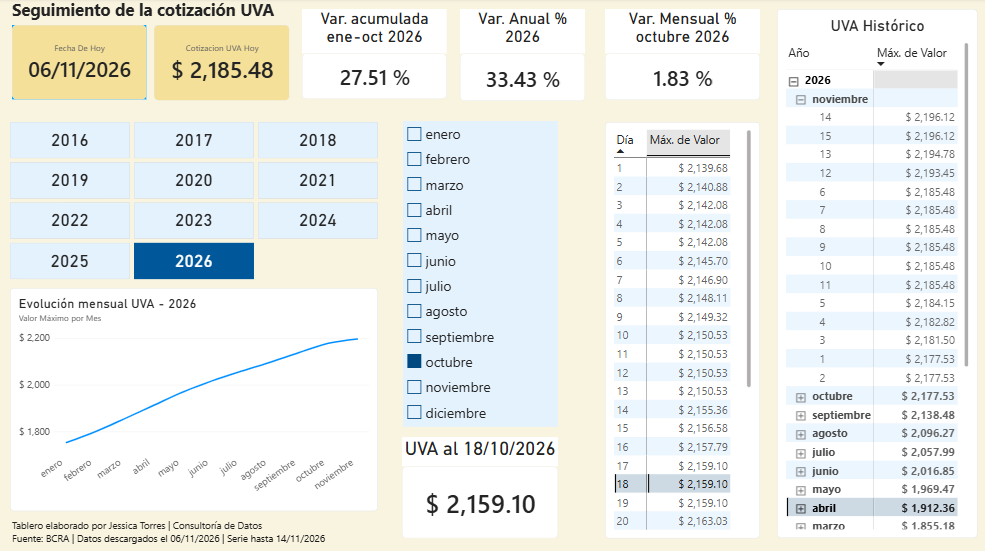

# 📈 Seguimiento de la cotización UVA

Tablero interactivo en Power BI para consultar la evolución de la UVA
(Unidad de Valor Adquisitivo) desde 2016, con indicadores de variación
y consulta de la cotización por fecha.

> **Estado:** versión inicial (v1.0). Seguiré mejorándolo.

## ¿Qué problema resuelve?

La UVA se ajusta por inflación y se usa, por ejemplo, en créditos
hipotecarios. Ver solo el valor del día no alcanza: lo que interesa es
cuánto cambió. Este tablero permite explorar la serie completa y medir
esa variación de forma simple.

## ¿Qué permite hacer?

- Ver la **cotización de hoy** y la evolución mensual de cada año.
- **Filtrar por año, mes y día** y consultar el valor de una fecha puntual.
- Medir la **variación mensual, interanual y acumulada del año**.
- Revisar el **histórico completo** por año y mes.

## Indicadores

| Indicador | Qué mide |
|---|---|
| Var. mensual | Cierre del mes elegido contra el cierre del mes anterior |
| Var. anual (interanual) | Cierre del período contra el mismo período del año anterior |
| Var. acumulada | Desde el cierre del año anterior hasta el mes elegido |
| UVA a la fecha | Valor de la fecha elegida (si no hay cotización, toma el último día disponible) |

## Cómo está hecho

- **Modelo de datos:** tabla de hechos `UVA` + tabla `Calendario`
  (marcada como tabla de fechas) con año, número y nombre de mes.
- **Medidas DAX:** inteligencia de tiempo (`DATEADD`, `LASTDATE`),
  títulos dinámicos según los filtros y manejo de fechas sin cotización.
- **Diseño:** jerarquía visual, paleta consistente, formato de porcentaje
  y moneda, y títulos que cambian con la selección.

**Herramientas:** Power BI, DAX, Power Query.

## Fuente de datos

Banco Central de la República Argentina (BCRA).
Datos obtenidos: 06/11/2026

## Próximas mejoras

- Resaltar en el gráfico el mes seleccionado.
- Eje de meses abreviado y gráfico de variación mensual.
- Aclarar la variación anual como "interanual" en el título.
- Actualización automática de los datos.

## Autora

**Jessica Torres**, Consultora de datos
Power BI | SQL | Python
